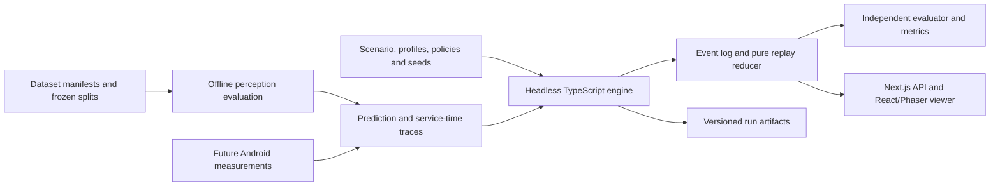

# SwarmSync design

Updated: 25 October 2026. Status: target design, not an implementation report. [SPEC.md](SPEC.md) owns requirements; [TODO.md](TODO.md) owns execution status. Existing code behavior is described in [architecture](docs/architecture.md) and [simulation model](docs/simulation-model.md).

## Architecture

Keep the application in `apps/web`. Use the same headless engine/reducer for batch runs and the UI. Run perception offline when needed and consume immutable predictions, rather than pretending the web renderer executes Android inference. The evaluator alone can access truth. Future native Android measurements feed the same profile/trace interface.

Separate scheduling, local knowledge, transport, policy, dataset, model-adapter, metric/replay and batch-run responsibilities. Keep heavy images/model binaries/raw logs outside tracked source. Commit small schemas, supported fixtures and provenance/split manifests only where release terms permit.

## Records and schema version

Research runs use schema version 2. Preserve the existing event envelope (`event_id`, `sim_time`, `type`, `source`, `target`, `payload`, `causality`) and add schema/run identity. Internally store integer milliseconds; expose seconds with millisecond precision. Causal references must resolve to earlier events in the same run.

| Record | Contents |
|---|---|
| Dataset manifest | Creator/release/terms, archive/split hashes, item IDs, modality/task namespace, transforms and availability |
| Task | Stable ID, sample IDs, arrival/deadline, destination, output contract; truth in a separate evaluator store |
| Model artifact | Checkpoint/head/revision/hash, conversion, shape/precision, runtime/backend, tokenizer/template and documented limits |
| Execution profile | Device/SoC, runtime/driver, concurrency, service-time samples, memory components, quality/energy provenance and uncertainty |
| Observation | Stable origin/ID/revision, prediction/geometry, evidence IDs, task/sample provenance, time and uncertainty |
| Job/message | Source/destination, queued/start/due times, reservation or encoded bytes, attempts, status and causal parents |
| Run manifest | Schema/config/hash, revision, seed streams, input/profile/split hashes, policy settings, horizon, outputs and stop reason |

Unavailable measurements are nullable with provenance. Labels remain dataset-namespaced. Old synthetic fixtures must not become measured profiles merely through a schema migration.

## Scheduling and failures

Use a discrete-event queue ordered by due time, event priority and stable insertion sequence. `advanceTo(t)` processes due events up to `t`. `step(dt)` advances logical time by `dt` seconds; the initial UI default is 0.5 s, while jobs may finish between steps. At equal horizons, wall time/playback speed must not alter results.

At the same timestamp: apply device/link changes first; process receipts and job completions next; admit new work; then evaluate deadlines. Receipt at the deadline is on time. Failure exactly at completion takes precedence and aborts it. Test and version this ordering.

A single owner advances an interactive run through a server-side pacing loop. Serialize per-run mutations. Tabs poll snapshots and issue controls, rather than each installing a tick producer. Version-2 step is paused-only; running step requests conflict. Speed changes wall-clock pacing only. Headless collection advances directly without a wall timer.

Use distinct seeded streams for workloads, placement, service times and external network/failure conditions. Pre-generate external traces before paired comparisons; changing policy cannot change outages or input difficulty by consuming RNG differently.

Start with one inference slot and one outbound transmission queue per device, plus a shared-memory admission budget. Additional concurrency requires characterized profiles. Publish inference results only on completion. A temporary device outage aborts active work, rejects receipt and stops admission while retaining committed knowledge. Recovery resumes eligible queues, never aborted completions. Requeue an aborted task at most once when still feasible before its original deadline; retain wasted work in accounting.

## Local knowledge, networking and policies

Each agent owns a versioned store of immutable observation copies. Local results enter after validation; remote results enter after receipt. Retain provenance, versions, age, duplicates and contradictions. No disconnected agent can consult global truth or another store.

Initial transport uses FIFO outbound queues. Serialization time is encoded bytes × 8 / configured link bit rate, followed by propagation delay. Availability/loss comes from frozen external traces. Count payload/control/acknowledgement/retry traffic. Drop on configured loss or endpoint failure. Allow at most one retransmission before the original deadline. Deduplicate `(origin, observation_id, revision)` on receipt; acknowledgements are the sender's evidence of remote delivery.

| Policy | Behavior |
|---|---|
| `LOCAL_ONLY` | No networking; report local perception and coordinator coverage separately. Diagnostic baseline. |
| `DIRECT` | Send completed results directly to their destination when reachable; no peer replication. |
| `FULL` | Broadcast each new observation/revision to reachable peers with loop suppression, queue/retry and deadline limits. |
| `SELECTIVE` | Send relevant, valid, unacknowledged, unexpired observations; relay only when discovered topology indicates a route to the destination. |

Initial selective ordering: earliest deadline, highest task relevance, smallest encoded payload, then observation ID. Relevance comes from task metadata, not truth or private recipient state. Record decision reasons. Treat any later utility formula/weights as a new policy version tuned on validation conditions. This heuristic is not a reproduction of learned communication papers or an established novel contribution.

First compare fixed prediction/service-time traces. Add adaptive local model/resolution choices with factorial ablations later. A classification-only task does not by itself establish multi-view collaboration benefits; direct delivery must be included beside flooding to avoid a trivial comparison.

## Dataset and perception pipeline

Acquire CrisisMMD images first, retaining the inspected severity split and release provenance. Train/evaluate an image-level severity head; save held-out predictions and checkpoint/transform hashes. Generic detector classes do not substitute for damage labels. Store correctness only with the evaluator.

Implement xBD independently using paired-image transforms and consistent building geometry; adopt the acquired release's official scoring. Keep pairs/related scenes together in additional holdouts. Add RescueNet later with verified terms, mask transformation/stitching and per-class evaluation. Do not invent photo/satellite/drone correspondence.

Timing and quality are separate profile dimensions. Use measured samples when available, otherwise explicitly synthetic/paper-derived assumptions and sensitivity ranges. Oracle labels are allowed only in named diagnostic conditions, not disguised as model predictions. Actual model runs record sampling/backend variability; only simulation traces are promised deterministic.

Future Android execution is a native adapter with pinned conversion/runtime, tested graph placement, tensor accuracy, resource accounting and sustained measurements. Do not infer actual GPU/NPU use from a profile label or successful call. Shared-memory accounting includes weights, activations, workspace and KV without duplication; INT4 weights do not imply INT4 cache.

## Language budget manager and output validation

Use the [SPEC budget defaults](SPEC.md#context-and-complete-outputs). Render the checkpoint template and tokenize everything actually sent. Select local evidence through an external provenance index rather than appending the full log. Record omitted IDs and preserve contradictions. Reset task/conversation state to prevent cross-agent private-context leakage.

The runtime adapter must report actual supported context/output caps and tokenizer/template identity, enforce those caps, and expose enough token/stop telemetry for completion checks. If the packaged runtime lacks an exact preflight tokenizer or typed stop reason, provide a compatible adapter or declare that configuration unsupported; do not invent SDK methods.

Generate one atomic bounded result: task ID, namespaced permitted label or uncertainty, at most four short evidence IDs and no unbounded prose. Vision geometry/masks stay in the perception pipeline. Test worst-case schema field lengths with the actual tokenizer. Use verified non-thinking mode and no automatic tool loop initially. If thinking/tools are later enabled, count all intermediate tokens, calls and time cumulatively.

Prompt the model with the allowed fields, brevity bounds and evidence-only rule. Use constrained decoding where the packaged backend supports it, then independently check schema, identity, label enum and evidence existence. Grammar validity is not factual accuracy. Keep streamed fragments provisional until completion classification and validation succeed.

Separate valid uncertainty, valid wrong answers and invalid/incomplete attempts. Record EOS/grammar stop, length/context stop, timeout, cancellation and errors; unknown termination cannot silently pass. Permit one smaller regeneration within original deadline/cumulative budgets, charge all costs, and otherwise record incomplete. Do not concatenate broken JSON continuations. See [budget rationale and tests](docs/benchmark-and-budget-design.md).

## Replay, APIs and persistence

Add typed events for task arrival/deadline, job lifecycle, message lifecycle, policy choice, knowledge changes, budget rejection and result acceptance/rejection. A pure reducer reconstructs devices/resources, local stores, queues, links and outcomes from the initial manifest and events. Snapshot caching may accelerate replay; full reduction remains the reference. Historical reads never mutate live state. Reset creates a new run ID.

Keep `/api/simulation/*` names and legacy seed/scenario defaults behind a legacy demo adapter. Add explicit schema-2 creation with versioned config. Version-2 snapshots include schema/run identity, logical time, paused/pacing state, full reconstructed state and an event cursor. Update client types for snapshots and nullable metrics. Never silently reinterpret legacy scripted completion as research success.

For version 2, `state?at` reconstructs state within recorded history and rejects future/out-of-range times. Topology and metrics must refer to the same snapshot time. Keep unknown simulation 404 and invalid input 400; use 409 for conflicting control/state operations. Add command IDs for idempotent mutations and event cursors for duplicate-free consumption.

Interactive deployment needs one persistent engine owner and real HTTP cross-route/session tests. A module-local Map is not a durable/multi-worker guarantee. Validate the single-process arrangement; defer serverless/distributed ownership. Research collection uses a headless runner and saved artifacts.

Write one external run directory containing `manifest.json`, `events.jsonl`, `metrics.json`, prediction references/hashes and terminal status. Finalize temporary output atomically; identify interrupted runs explicitly. Ground truth remains evaluator-only. A standalone evaluator validates references and recomputes metrics independently.

## Metrics, viewer and validation

Measure delivered, correct and on-time outcomes separately. Useful throughput uses the full configured horizon. Include failed/late/uncertain results, quality, latency/freshness distributions, byte outcomes, generation interruptions, memory peaks and energy provenance. Do not count duplicates as unique work or infer knowledge count from messages.

Wire the viewer to snapshots through the API: real HUD values, devices/agents, links, event-backed packets, selection/causality, meaningful lenses and historical timeline. Show live/replay state explicitly. Add actual styles and loading/empty/error/reset/teardown behavior. Frontend animation never creates scientific events.

Validation order: hand-calculated engine/transport fixtures; tokenizer/output interruption cases; dataset/geometry checks; independent metrics/replay; HTTP ownership/idempotency; browser behavior; pilot; frozen study. Use separate pilot seeds and initially 30 paired final seeds per condition, freezing the final count/protocol before collection. Documentation-only updates need link/structure checks, not claims of newly validated runtime behavior.
